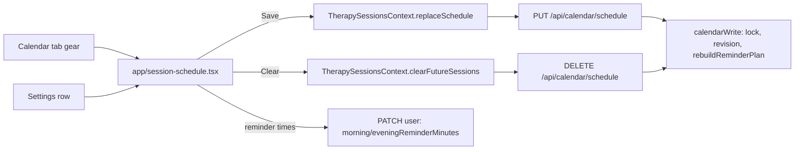

# Session schedule settings

Status: built (2026-10-28). Spans `therapy-app-frontend` (branch `fix-calendar`) and `therapy-app-backend` (branch `feat/schedule-settings`, on top of `feat/calendar-series-materialised-reminders`).

## 1. Product

**Problem.** After onboarding, users have no way to change how often their sessions repeat (for example weekly to fortnightly). They also have no single way to clear all their future sessions. The only option today is to tap one session, choose the scope for future sessions, and end that one series. One-off sessions have to be deleted one at a time.

**What we add.**
- A gear icon to the right of the next-month arrow on the Calendar tab. It opens a Schedule screen.
- The same screen is reachable from a row in the Settings tab.
- The Schedule screen shows only what onboarding asked for, with the same copy and components:
  - When is your next session? (Date, Time)
  - How often are your sessions? (Every week, Every two weeks, Once a month, It varies)
  - Choose times that fit your routine (Morning reviews, Evening reviews)
- **Save** replaces the future schedule with the new one.
- **Clear future sessions** removes every session from now on, after a confirm.

**Success check.**
- Change weekly to fortnightly and save. The calendar shows sessions every two weeks from the chosen date, nothing weekly remains after it, and the reminder dots follow the new gaps.
- Clear future sessions. The calendar has no sessions from now on, past sessions are unchanged, and no reminders are planned.
- Both are verified end to end in the simulator against a local backend, plus backend integration tests.

## 2. Architecture



**New endpoints** (in `calendar.routes.ts`, behind `authenticate`, honour `If-Match` revision like the existing writes):

| Method | Path | Body | Effect |
|---|---|---|---|
| `PUT` | `/api/calendar/schedule` | `{ startsAtUtc, durationMin?, repeat?: 'weekly' \| 'fortnightly' \| 'monthly' }` | Clear the future (below), then create a series (with `repeat`) or a single session (without it, which is "It varies") |
| `DELETE` | `/api/calendar/schedule` | none | Clear the future |

**Clear the future** (one function, inside the `calendarWrite` transaction):
1. Every series with no end, or an end after `now`, gets `endsAtUtc = now`, so the nightly extension never brings it back.
2. Delete every session of this user with `startsAtUtc >= now`: series instances, hand-moved ones and one-offs.

`calendarWrite` already rebuilds the reminder plan in the same transaction, so reminders follow with no extra work. Past sessions and their notes are untouched.

No schema changes. `TherapySeries` already has `endsAtUtc`.

## 3. Program design

### Backend

| File | Change |
|---|---|
| `src/services/therapySeries.ts` | add `clearFutureSchedule(userId, now, session): Promise<number>` |
| `src/controllers/calendarSchedule.controller.ts` (new) | `replaceSchedule`, `clearSchedule` |
| `src/routes/calendar.routes.ts` | `router.put('/schedule', ...)`, `router.delete('/schedule', ...)` |
| `src/utils/validation.ts` | `validateReplaceSchedule` (Zod: ISO date in the future, `repeat` in `SERIES_CADENCES`, optional `durationMin`) |
| `tests/calendarSchedule.test.ts` (new) | see tests |

```ts
// services/therapySeries.ts
export async function clearFutureSchedule(
  userId: Types.ObjectId, now: Date, session: ClientSession,
): Promise<number>;

// controllers/calendarSchedule.controller.ts
// PUT  -> 200 { revision, session, series?, deleted, created }
// DELETE -> 200 { ok: true, deleted, revision }
export async function replaceSchedule(req: AuthRequest, res: Response, next: NextFunction): Promise<void>;
export async function clearSchedule(req: AuthRequest, res: Response, next: NextFunction): Promise<void>;
```

`replaceSchedule` reuses `createSeries` for the repeating case and the existing single-session path for "It varies".

### Frontend

| File | Change |
|---|---|
| `src/api/therapy.ts` | `replaceSchedule(input, revision)`, `clearFutureSchedule(revision)` |
| `src/context/therapy-sessions/TherapySessionsContext.tsx` | `replaceSchedule({ firstSessionAt, cadence })`, `clearFutureSessions()`, both through the existing `commit` |
| `app/session-schedule.tsx` (new) | the screen, in `SettingsPageShell` like `reminder-settings.tsx` |
| `src/components/schedule/` (new) | `SchedulePickerRows` (the reminder settings rows) and `ClearFutureConfirm` |
| `src/components/ui/Dropdown.tsx` (new) | `Dropdown` and `ChoiceRow`, shared by the language page and "how often" |
| `src/components/therapy-calendar/TherapyCalendar.tsx` | gear icon to the right of the next-month arrow, outside the library's header so VoiceOver can reach it |
| `app/(tabs)/settings.tsx` | one more entry in the categories list |
| `src/i18n/locales/{en,de,es,fr}.json` | new keys (below) |

```ts
// context
replaceSchedule: (input: { firstSessionAt: Date; cadence: CadenceId; durationMin: number }) => Promise<void>;
clearFutureSessions: () => Promise<void>;
```

**Prefill:** the next future session gives the date and time. The cadence comes from the series that session belongs to; if it has no series, "It varies" is selected. Reminder times come from `reminderScheduleSettings`.

**Main flow:** gear, then `router.push('/session-schedule')`, then Save. Save calls `replaceSchedule` (`PUT /api/calendar/schedule`) only when the date, time or cadence changed, and `updateCurrentUser` only when a reminder time changed, so a time-only edit leaves hand-moved sessions alone. The context refetches the calendar, then `router.back()`.

**Reminder times** save the way `reminder-settings.tsx` already does (`updateCurrentUser`). That screen stays as it is.

### Tests

Backend (`tests/calendarSchedule.test.ts`, mongodb-memory-server):
- Replace weekly with fortnightly: the old series is ended at now, the future is fortnightly, and the past is unchanged.
- Replace with no `repeat`: exactly one future session and no open series.
- Hand-moved and one-off future sessions are removed by both endpoints.
- After clearing, the nightly extension (`seriesNeedingExtension`) adds nothing.
- The reminder plan has no future rows after clearing.
- A stale `If-Match` gets 412.

Frontend:
- API tests for both calls.
- Context tests for `replaceSchedule` and `clearFutureSessions`.
- A screen test: prefill, change cadence, save, and the call made.
- `calendarBackendIntegration.test.ts` runs replace then clear against the local backend.

### New copy (only what has no existing string)

| Key | Proposed English |
|---|---|
| `schedule.settingsTitle` | Schedule |
| `schedule.save` | Save |
| `schedule.clearFuture` | Clear future sessions |
| `schedule.clearFutureTitle` | Clear future sessions? |
| `schedule.clearFutureMessage` | This removes every session from today on. Past sessions stay on the calendar. |
| `schedule.clearFutureConfirm` | Clear |

The confirm reuses the end-series confirm's layout from `ScheduleModal` (solid danger pill plus glass "Keep").

## Decisions

Confirmed 2026-10-26:
1. Save replaces everything from now on, including sessions moved by hand and one-offs.
2. Clear removes one-offs as well, not only series.
3. The Settings entry is a row on the Settings tab.
4. Reminder times are on this screen as well as the existing Reminder settings screen.

Still open:
5. New copy in the table above (also needs de, es and fr).

## Slices

1. Backend: `clearFutureSchedule`, both endpoints and tests.
2. Frontend: API and context methods against the local backend.
3. Schedule screen with shared onboarding components, and the gear and Settings entry.
4. Copy in all four locales.
5. One end-to-end check in the simulator at the end.
